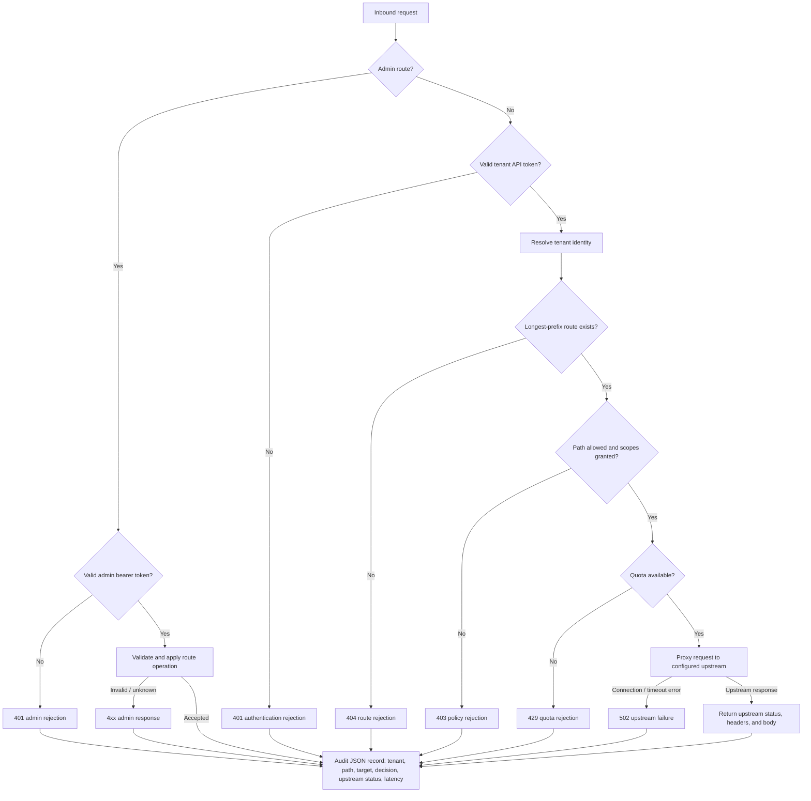

# Multi-tenant API gateway

A Python 3.12+ asynchronous reverse proxy built with FastAPI, Pydantic v2, HTTPX, and Uvicorn. It authenticates tenants, applies tenant policies, routes requests to configurable upstreams, and writes a JSON audit record for each HTTP request.

## Set up and run

```powershell
py -3.13 -m venv .venv
.\.venv\Scripts\Activate.ps1
python -m pip install -e ".[dev]"
Copy-Item config.example.json config.json
```

Replace both example tokens in `config.json` with independently generated secrets (at least 32 characters). Generate one with:

```powershell
python -c "import secrets; print(secrets.token_urlsafe(32))"
```

Run the test suite and start the gateway:

```powershell
python -m pytest
python -m gateway.main
```

The gateway listens on `127.0.0.1:8080` by default. Set `GATEWAY_CONFIG` to load a different JSON configuration file. Use `0.0.0.0` only when remote connections are needed and the service is protected by a trusted network edge. Audit events are newline-delimited JSON written to standard output.

## Configuration and token issuance

`config.example.json` shows the supported configuration:

- `admin_token`: separate bearer credential for route administration.
- `tenants`: unique tenant IDs and API keys, allowed path prefixes, granted scopes, and requests-per-minute quotas.
- `routes`: unique route IDs, path prefixes, HTTP(S) upstream base URLs, and scopes required to use each route.

Issue tenant keys and the admin key from a cryptographically secure random source; never use the example values. Keep `config.json` out of source control. The gateway hashes tokens and compares fixed-length digests in constant time; authenticated tenant identities do not retain their API keys. Tenant callers can supply a key using `X-API-Key` or `Authorization: Bearer <token>`, but not both. Gateway credentials are removed before forwarding.

Prefixes match only complete path segments (`/api` matches `/api` and `/api/items`, not `/apix`). The longest matching prefix wins. The full incoming path is appended to the configured upstream base path, and the query string is preserved. An upstream base URL cannot include credentials, a query, or a fragment.

### Runtime route administration

Every admin operation requires `Authorization: Bearer <admin_token>`:

```powershell
$admin = "your-admin-token"
$headers = @{ Authorization = "Bearer $admin"; "Content-Type" = "application/json" }
$route = @{
  id = "catalog-v2"
  prefix = "/v2/catalog"
  target = "https://catalog.internal"
  required_scopes = @("catalog:read")
} | ConvertTo-Json

Invoke-RestMethod -Method Put -Uri http://127.0.0.1:8080/admin/routes/catalog-v2 -Headers $headers -Body $route
Invoke-RestMethod -Method Get -Uri http://127.0.0.1:8080/admin/routes -Headers @{ Authorization = "Bearer $admin" }
Invoke-RestMethod -Method Delete -Uri http://127.0.0.1:8080/admin/routes/catalog-v2 -Headers @{ Authorization = "Bearer $admin" }
```

Changes apply immediately and are held in memory; a restart restores the routes from the startup configuration. Restrict access to the admin endpoint at the network layer as well as with its token.

### Tenant request example

```powershell
Invoke-RestMethod -Uri http://127.0.0.1:8080/api/items -Headers @{ "X-API-Key" = "your-tenant-key" }
```

Unauthenticated requests receive `401`; missing routes receive `404`; path and scope policy failures receive `403`; quota failures receive `429`; upstream connection failures receive `502`.

## Request flow



## Security assumptions and known gaps

### Threat model

Tenant API keys are bearer credentials: anyone holding a key can act as that tenant. A tenant can request only configured routes under its path allowlist and must possess every scope required by the selected route. Per-tenant quotas are enforced before an upstream call is made. Tenant-supplied authorization and API-key headers are stripped, as are hop-by-hop headers.

Only a caller with the separate admin token can add, update, list, or delete routes. Tenants cannot select destinations or use route administration. The admin credential and startup configuration are trusted.

### Known gaps and deployment requirements

- Route state and rate-limit counters are process-local and are lost on restart; multiple replicas do not share either. Use a durable configuration store and distributed limiter for multi-instance deployments.
- Quotas use a fixed one-minute window, so bursts around a minute boundary are possible.
- Admin-configured destinations can access networks reachable by the process. Protect the admin API and enforce outbound network policy/egress allowlists to mitigate SSRF and access to internal services.
- The service does not terminate TLS. Run it behind a trusted TLS-terminating load balancer and protect traffic between that edge and the gateway.
- There is no tenant key rotation/revocation API, key expiry, per-tenant upstream credential injection, or per-tenant concurrency limit.
- Request bodies are streamed and are not subject to a configured size limit. Put an appropriate request-size limit at the trusted edge.
- Audit events are written to stdout; durable storage, access control, retention, tamper evidence, and delivery guarantees must be provided by the deployment's log pipeline.
- There is no circuit breaker or canary routing. Upstream calls have a 30-second timeout.

## Upload to a personal GitHub repository

Run these commands from the `APIGateway` project directory after installing Git and the GitHub CLI (`gh`). Sign in to your personal GitHub account and choose a repository name and visibility; use a private repository if the assessment instructions or your preferences require it.

```powershell
gh auth login
git init
git add .gitignore README.md pyproject.toml config.example.json gateway tests .github/workflows/ci.yml
git status --short
git diff --cached --check
git commit -m "Build multi-tenant API gateway"
git branch -M main
gh repo create multi-tenant-api-gateway --private --source=. --remote=origin --push
```

Review `git status --short` before committing. `config.json` contains credentials and is ignored by Git; never force-add it or commit real API keys. The explicit `git add` command above publishes the source, tests, sample configuration, workflow, and this README without uploading the assessment PDF. Change `--private` to `--public` only if you intend to make the repository public.

## CI

GitHub Actions runs the complete test suite on pushes and pull requests using Python 3.13.
